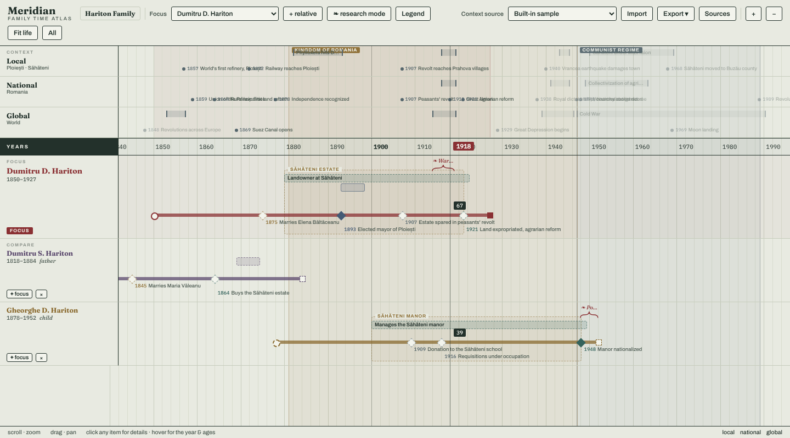

# Meridian — Family Time Atlas

> *Meridian: the cartographic line you read positions from — echoing the vertical crosshair that anchors every life to shared historical terrain.*

Meridian is a genealogical timeline. Instead of a family tree, it lays lives out as horizontal lanes on one shared, zoomable year axis, with local, national and world history above them. You read a family as parallel biographies: who was alive at the same time, how old each person was in a given year, which wars and reforms they lived through.



It runs entirely in your browser. There is no server and no account, and your data stays on your computer.

**Use it now:** <https://costinfl.github.io/meridian/> (the app is published from this repository with GitHub Pages).

## Contents

- [What you can do](#what-you-can-do)
- [Five-minute tour](#five-minute-tour)
- [Your data and backups](#your-data-and-backups)
- [Run it locally](#run-it-locally)
- [Documentation](#documentation)
- [Project status](#project-status)
- [Browser support](#browser-support)

## What you can do

- **Compare lives in time.** One *focus* person, any number of relatives below, history above. Hover anywhere and a crosshair shows the year and everyone's age.
- **Record a life.** Birth and death, point events (marriage, office, property, military…), roles and occupations as bars, named groups of years, research brackets with notes, and full-height era bands.
- **Keep your sources.** Attach scans, documents, audio, video, links or transcriptions; cite them from any item; pin an image to a year.
- **Separate what you know from what you suspect.** Every fact is *unverified* (dashed, hollow) until you mark it *verified* (solid, ✓).
- **Organise several projects**, each saved automatically in the browser.
- **Share and back up** with a single `.zip` bundle, and exchange data with other genealogy software through GEDCOM 5.5.1.

## Five-minute tour

1. Open the app. The first time, it loads a sample project: the Hariton family of Ploiești and Săhăteni, Romania.
2. **Scroll** to zoom, **drag** to pan. Move the mouse over the board to see the year and each person's age.
3. Choose another person in the **Focus** list, or click **+ relative** to add a comparison lane.
4. Click any marker or bar to read its details.
5. Turn on **research mode** to edit: click an item to change it, click empty space in a person's lane to add an event, or drag across a lane to add a period, group or bracket.
6. Open **Sources** to add a document or link, then cite it from an item.
7. Use **Export ▾ → Meridian project (.zip)** to save a backup.

The full walkthrough is in the [user guide](docs/user-guide.md).

## Your data and backups

- Everything is stored in your browser's IndexedDB, on your device, for the site you opened (the public site and a local copy keep separate data).
- Changes are saved automatically about 1.5 seconds after you stop editing. A red dot next to the project name means a save is pending.
- **Browsers can delete site data** (when you clear browsing data, in private windows, or when the disk is nearly full). The `.zip` bundle is your backup: export one regularly and keep it somewhere safe.
- A bundle contains the whole project and its attached files. Import it on any computer with **Import**.

## Run it locally

You need [Node.js](https://nodejs.org/) 22.22.2 or newer and a current npm.

```bash
git clone https://github.com/costinfl/meridian.git
cd meridian
npm install -g npm@latest   # the lockfile needs a recent npm (see note below)
npm ci
npm run dev
```

The app opens at <http://localhost:5173/meridian/> (note the `/meridian/` path).

| Command | What it does |
| --- | --- |
| `npm run dev` | Development server with hot reload |
| `npm test -- --run` | Run the test suite once (`npm test` watches for changes) |
| `npm run build` | Production build into `dist/` |
| `npm run preview` | Serve the production build locally |

**If `npm ci` fails** with "package.json and package-lock.json are not in sync", your npm is too old. Either update it as shown above or run `npx -y npm@latest ci` without installing anything globally.

More detail, including the test setup, deployment and troubleshooting, is in the [development guide](docs/development.md).

## Documentation

| Document | For |
| --- | --- |
| [User guide](docs/user-guide.md) | Using the app: every screen, button and file format |
| [Development guide](docs/development.md) | Running, testing, building, deploying, contributing |
| [Architecture](docs/architecture.md) | How the code and data are organised |
| [Architecture decisions](docs/adr/README.md) | Why key choices were made (ADR-0001 to 0005) |
| [Evidence layer design](docs/evidence-layer/evidence-model.md) | Target design of the evidence features |
| [Evidence layer plan](docs/evidence-layer/IMPLEMENTATION_PLAN.md) and [progress](docs/evidence-layer/PROGRESS.md) | What is being built, phase by phase |

## Project status

The timeline, sources, projects, bundles and GEDCOM exchange work today.

An **evidence layer** is being added in phases: document ingestion, OCR, extraction of people and facts with a citation to the exact region of a scan, search, and matching of the same person across records. Of the ten phases (0 to 9), phases 0 to 4 are built: the data model, storage, and conversion of existing facts into evidence. Phases 5 to 9 are not started. It is switched off by default; you can preview it per project from **Projects → Evidence layer (preview)**. What it does today is described in the [user guide](docs/user-guide.md#evidence-layer-preview).

Known gaps in the current app:

- People cannot yet be created or deleted in the interface; they come from the sample, a GEDCOM import or a bundle import.
- Parents and spouses cannot yet be edited in the interface, and GEDCOM import does not read family links.
- The context lanes (local, national, world history) are the built-in sample only.

## Browser support

Any current desktop browser works for the timeline. Chrome or Edge is recommended, because the evidence layer will read documents from a folder on your computer through an API that only Chromium browsers provide. The app is designed for a mouse or trackpad and a wide screen.

Fonts (Fraunces, Archivo, IBM Plex Mono) are loaded from Google Fonts; without a connection the app falls back to system fonts.
