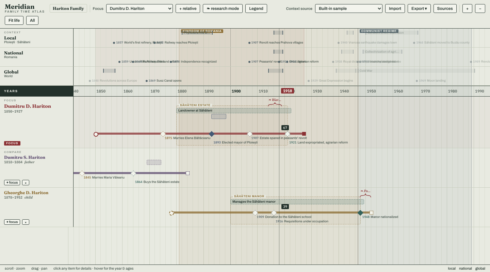

# Meridian user guide

This guide explains how to use Meridian. To install or run it on your own computer, see the [README](../README.md#run-it-locally).

- [The screen](#the-screen)
- [Moving around](#moving-around)
- [People on the board](#people-on-the-board)
- [Reading a lane](#reading-a-lane)
- [Editing: research mode](#editing-research-mode)
- [Verified and unverified](#verified-and-unverified)
- [Sources](#sources)
- [Projects](#projects)
- [Saving, backup and sharing](#saving-backup-and-sharing)
- [GEDCOM](#gedcom)
- [Evidence layer (preview)](#evidence-layer-preview)
- [Limits you should know about](#limits-you-should-know-about)
- [Questions and problems](#questions-and-problems)

## The screen



From top to bottom:

| Area | What it shows |
| --- | --- |
| **Toolbar** | Project name, focus person, and the main actions |
| **Context** | History lanes: Local, National, Global. Events and periods outside the focus person's lifetime are dimmed; a soft tint marks the years the focus person was alive |
| **Years** | The time axis, shared by every lane |
| **Focus** | The person you are studying |
| **Compare** | Relatives you have added, one lane each |
| **Status bar** | Short hints on the left; on the right, `local`, `national`, `global` switch each context lane on or off |

Toolbar buttons, left to right:

| Control | Action |
| --- | --- |
| Project name | Opens **Projects** (create, open, rename, delete). A red dot means changes are waiting to be saved |
| **Focus** | Chooses the focus person |
| **+ relative** | Adds a comparison lane |
| **research mode** | Switches editing on and off |
| **Legend** | Explains the event markers |
| **Context source** | Only "Built-in sample" for now |
| **Import** | Loads a Meridian bundle (`.zip`) or a GEDCOM file (`.ged`) |
| **Export ▾** | Saves a Meridian bundle or a GEDCOM file |
| **Sources** | Opens the sources panel; the number is how many sources the project has |
| **Evidence** | Only shown when the evidence preview is switched on |
| **+** / **−** | Zoom in and out |
| **Fit life** | Frames the focus person's lifetime |
| **All** | Frames everyone in the project |

## Moving around

| Gesture | Action |
| --- | --- |
| Scroll wheel | Zoom towards the mouse pointer |
| Horizontal scroll (trackpad) | Pan |
| Drag | Pan (when research mode is off) |
| Move the mouse over the board | A vertical line follows the pointer; the year is shown on the axis and each person's age at that year appears on their lane |
| Hover a marker | A tooltip with its details |
| Click a marker, bar, group or bracket | Opens its details |

Zoom and position are remembered per project.

## People on the board

- The **focus** person has the tall lane in the middle. Choose them from the **Focus** list.
- Click **+ relative** to add someone to **Compare**. The list shows everyone not yet on the board, with their relationship to the focus person (father, mother, spouse, child, sibling, grandparent, grandchild, or relative) and their years.
- Each comparison lane has **⌖ focus** (make this person the focus; the previous focus moves to Compare) and **×** (remove the lane; the person stays in the project).

People cannot be created in the app yet. They come from the sample project, a GEDCOM import, or a bundle import (see [Limits](#limits-you-should-know-about)).

## Reading a lane

| Mark | Meaning |
| --- | --- |
| Thick line | The person's life, from birth to death |
| Circle at the start | Birth |
| Square at the end | Death |
| Diamond with a year and label | An event. Its colour shows the type: marriage, office or role, property, military, birth, death, media, or note (see **Legend**). Labels hide when you zoom far out |
| Labelled bar | A role or occupation over a span of years (for example *Mayor of Ploiești*). Overlapping bars stack |
| Dashed box with a tab | An event group: a named range of years that ties events together (for example *Săhăteni estate*) |
| Curly bracket with italic text | A research bracket: your own note about a range of years |
| Small image marker | A media pin: a picture or document attached to a year |
| Full-height coloured band with a label | An era that applies to the whole board (for example *Communist regime*) |

Solid, filled marks are **verified**; dashed, hollow marks are **unverified** (see below).

## Editing: research mode

Click **research mode**. The button shows a ✓ while it is on, and dragging no longer pans the board.

| To do this | Do this |
| --- | --- |
| Change an item | Click it, edit, **Save** |
| Delete an item | Click it, then **Delete** in the editor. A bracket also has a small × next to its text |
| Change an era | Click its label at the top of the board |
| Add an event | Click empty space in a person's lane at the right year |
| Add a role, group, bracket, era or media pin | Drag across a person's lane over the years it covers, then pick the type in the editor |
| Add an era from a context lane | Drag across a context lane |
| Edit birth or death | Click the birth circle or death square |

The editor has these fields, depending on the type:

- **Type** of item: Event, Role / occupation, Event group, Bracket, Era band, Media pin.
- **Title**, and **Year** or **From / To**.
- **Marker type** (events only) and **Colour**.
- **Source** (optional, required for a media pin): one of the project's sources.
- **Note**: details, context, or open research questions.
- **Verification**: tick when the fact is established.

Birth and death have only year, place and verification.

Turn research mode off to pan by dragging again. With it off, clicking an item shows a read-only view with its source.

## Verified and unverified

Every fact starts **unverified**. Tick **Verified** in its editor when you are satisfied it is established, ideally with a source attached.

- Unverified: dashed outline, hollow marker.
- Verified: solid outline, filled marker, and a ✓ in labels and tooltips.

Verification matters for exchange: **GEDCOM export contains only verified facts**, so unconfirmed guesses do not spread into other people's trees. The Meridian bundle always contains everything.

Sources have their own **Verified source** switch. A source is cited in GEDCOM only when both the fact and the source are verified.

## Sources

Click **Sources** to open the panel on the right.

**Add a source** with **+ Add**:

| Field | Notes |
| --- | --- |
| Type | Image, document, audio, video, link (URL), or text |
| Title | Required |
| File / URL / Text | A file for image, document, audio and video; an address for a link; a transcription or extract for text |
| Date | Free text, for example `1923` or `circa 1900` |
| Repository | Where the original is held, for example an archive |
| Description | A short description |
| Citation (APA7) | The full reference. It always travels with the project, even if the file is removed from a bundle |
| Verified source | Tick when you trust the source |
| Link to people | The people this source concerns |
| Year range | Optional years the source covers |

In the list you can filter by type, switch **Verified** on or off, and remove a source. A **File missing** tag means the source came from a bundle whose media file had been removed; its citation is kept.

**Use a source**: in an item's editor, choose it under **Source**. In the read-only view of an item, images are shown and files and links can be opened.

Attached files are stored in your browser together with the project. Large scans make bundles large.

## Projects

Click the project name in the toolbar.

- **+ New project** creates an empty project.
- **Open** switches project. **✎** renames, **×** deletes (you are asked to confirm). Deleting cannot be undone, so export a bundle first if in doubt.
- **Evidence layer (preview)** switches the unfinished evidence features on for the open project (see below).

The first time you open Meridian, it creates the sample project *Hariton Family* so you have something to explore.

## Saving, backup and sharing

**Saving is automatic.** About 1.5 seconds after your last change the project is written to your browser's storage. The red dot beside the project name disappears when it is saved.

**Your data lives in this browser only.** It is not uploaded anywhere. It is also not protected from the browser: clearing site data, using a private window, or a nearly full disk can remove it.

**Back up with a bundle.** **Export ▾ → Meridian project (.zip)** saves one file containing:

- `project.json`: the whole project, including every source's details and citation;
- `media/`: the attached files;
- `evidence.json`: evidence the project refers to, if you use the evidence preview.

**Restore or share** with **Import**, choosing the `.zip`. An imported project is added as a new project named "… (imported)"; it never replaces an existing one.

You may delete large files from the `media/` folder of a bundle before sharing it. The project still imports, and those sources keep their citation and are tagged **File missing**.

## GEDCOM

GEDCOM is the common exchange format of genealogy programs. Meridian reads and writes version 5.5.1.

**Export** (**Export ▾ → GEDCOM (.ged)**) writes:

- every person with name and sex;
- family links (parents, spouses, children);
- **only verified** births, deaths, events, roles and groups;
- source records for verified sources cited by those facts.

Roles are written as occupations with a date range, events as generic events with a type, and groups as notes. Colours, brackets, eras, media pins and unverified facts are not part of GEDCOM; use a bundle to keep them.

**Import** (**Import**, choosing a `.ged` file) adds the people in the file to the open project, with their birth and death year and place, occupations, events, notes and sources. Add them to the board with **+ relative**.

GEDCOM import does **not** read family links yet, so imported people have no parents or spouses in Meridian. Imported facts are always unverified, even from a file that Meridian exported: tick **Verified** again once you have checked them.

## Evidence layer (preview)

The evidence layer is under construction. Its goal is to tie every fact to the exact place in a document where it was read, and to keep what a source says separate from what you conclude.

Switch it on for the open project in **Projects → Evidence layer (preview)**. An **Evidence** button appears in the toolbar. (Adding `?evidence=1` to the address also shows it, without changing the project.)

What the panel offers today:

1. **Legacy facts report.** A summary of the facts on your timeline: how many of each kind, how many have a source, how many are verified, and anything unusual (for example a verified fact with no source).
2. **Convert … legacy items to evidence.** Records each fact as *proposed* statements, cited to the fact's own source or to a "Legacy Meridian data" source. A birth or death becomes two statements, one for the date and one for the place. This does not change your timeline, and it confirms and accepts nothing.
3. **Confirm … verified facts.** A separate step that records your earlier *Verified* ticks as confirmations. Facts you did not verify stay proposed.
4. **Accept link**, once per person. Conversion creates a record of each person from their old timeline data and *suggests* that it is that person. You accept each suggestion yourself.
5. **Documents.** Register your scans and documents and read their text; see [Documents](#documents) below.
6. **Storage line.** Whether the browser has granted persistent storage, how much space is used, and when you last exported a bundle.

After conversion, the evidence follows your edits. Ticking or unticking **Verified** records that decision. Changing a fact's year, place, label or dates records the new value as replacing the old one; the old value is kept in the history, never deleted. Nothing else in the app behaves differently yet. Extracting people and facts from documents, search, and matching people across records arrive in later phases; see the [plan](evidence-layer/IMPLEMENTATION_PLAN.md).

Export a bundle before trying the preview on a project you care about.

### Documents

The **Documents** part of the Evidence panel registers your scans and documents and reads their text. Everything happens in your browser: nothing is uploaded.

**Supported files:** PDF, DOCX, JPG, PNG. Old Word `.doc` files are not read; open them in Word or Google Drive and save as DOCX or PDF. TIFF files are registered but most browsers cannot display them, so convert them to PNG or PDF before reading.

**Bring documents in**, either way:

- **Link documents folder** (Chrome or Edge). Choose the folder that holds your documents, for example your Google Drive folder on this computer. Meridian only reads it. Then click **Scan folder**. Scan again whenever you add, move or rename files: a file is recognised by its content, so moving or renaming it does not create a duplicate. After restarting the browser you may be asked again for permission to read the folder.
- **Add files…** or drag files onto the section (any browser). These files are stored inside the browser.

A file that has the same name as one you already have but different content (a better scan, another edition) is flagged. Choose **Keep both** or **Replace old**. Replacing keeps the old file on record, because anything read from it still points to it.

**The Inbox.** A new document has no source until you say which work it belongs to. Type the source title and click **Set source**.

**Sidecar files (optional).** To set the source while scanning, put a small text file next to the document, named like the document plus `.meta.json`. For `botezuri-1843.pdf` that is `botezuri-1843.pdf.meta.json`:

```json
{
  "sourceTitle": "Registrul de botezuri, Sf. Nicolae, 1843",
  "repository": "Arhivele Naționale Prahova",
  "date": "1843",
  "pageLabel": "f. 23v",
  "accessUrl": "https://example.org/register",
  "kind": "parish-register",
  "handwritten": true
}
```

Every field is optional. `kind` is one of `parish-register`, `civil-register`, `census`, `newspaper-title`, `newspaper-issue`, `book`, `archival-document`, `image`, `web`, `other`. `pageLabel` is the printed folio or page number of the first page. Unknown fields are ignored with a warning.

**Read.** **Read** (one document) or **Read N unread** (all) extracts the text of every page:

- a PDF that contains text, or a DOCX, gives its own text straight away;
- a scanned PDF or an image goes through OCR (Romanian). OCR takes a few seconds per page and downloads about 6 MB the first time;
- a document whose source is marked `"handwritten": true` is not OCR'd; its pages wait for handwriting recognition, which comes later.

A document already read is not read again unless you click **Read again**. **Cancel** stops after the current page; reading again later continues with the pages still missing.

**Processing runs** lists the recent runs and any page that failed, with the reason. **Re-run page** tries that page again, for example after you are back online.

**Page image cache.** Pages are drawn into images for OCR and kept to save time. **Clear cache** frees the space; the images are made again when needed.

**Review text.** OCR is not perfect, and on handwriting it mostly fails. A document marked **needs review** has pages where the OCR confidence is low or the text does not look like words. Click **Review text** to see the page image next to its text:

- **Transcription (as read)** is exactly what the machine read. It is never changed.
- **Modern reading** is your own text for the page. Click **Start reading from transcription** to begin with a copy of the machine text (a page without text starts empty). Write uncertain parts in [square brackets]; they are highlighted.
- To correct a fragment, click a [bracketed] part or select any text with the mouse. Type the correct text, and if you know it from another source (an archive index, another record), paste its web link and an optional note. **Save correction**. The corrected text is underlined with a ↗ link to the source, and the **Corrections** list shows what it was before.
- **Edit whole text** lets you type freely (for example a full transcription of a handwritten page); typed changes have no source link.
- Every save is kept as a version; **History** shows them all. Use **+** and **−** to zoom the page image, and **‹ ›** to move between pages.

A page with a reading counts as **reviewed** in the document list.

The text read from documents is stored as evidence, but nothing uses it on the timeline yet. Extracting people and events from it is the next phase.

## Limits you should know about

- **No way to add or delete a person in the app.** Use GEDCOM or bundle import.
- **No way to edit parents and spouses in the app.** Relationships come from the sample or a Meridian bundle.
- **GEDCOM import ignores family links.**
- **Dates are years.** Days and months are not stored on the timeline.
- **Context lanes are fixed** to the built-in Romanian sample; the other "Context source" options are placeholders.
- **One browser, one device.** There is no sync. Move data with bundles.
- **Desktop only.** The board needs a mouse or trackpad and a wide window.

## Questions and problems

**My project is gone.** Check that you are on the same address and in the same browser and profile as before (data on `costinfl.github.io` and on `localhost` are separate), and not in a private window. If the browser's site data was cleared, restore from a bundle with **Import**.

**The red dot does not go away.** Saving happens after you stop editing for a moment. If it stays for long, the browser may be refusing to store data (private window, full disk); export a bundle straight away.

**I cannot drag the board.** Research mode is on. Click **research mode** again.

**My facts are missing from the GEDCOM file.** Only verified facts are exported. Tick **Verified** on them, or use the bundle.

**The text looks plain.** The fonts come from Google Fonts and need a connection the first time.

**An imported source is tagged "File missing".** The media file was not in the bundle. The citation is kept; attach the file again by adding a new source if you have it.
