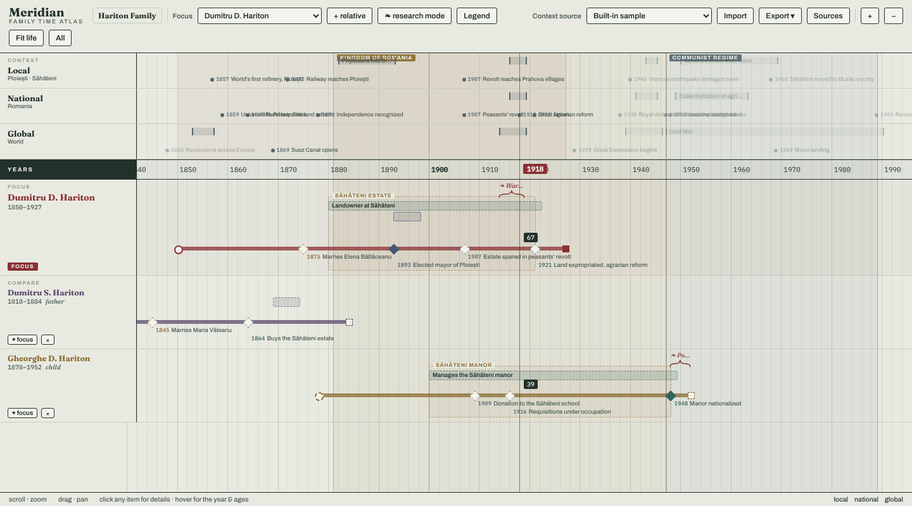

# Meridian user guide

This guide explains how to use Meridian. To install or run it on your own computer, see the [README](../README.md#run-it-locally).

- [The screen](#the-screen)
- [Moving around](#moving-around)
- [People on the board](#people-on-the-board)
- [Reading a lane](#reading-a-lane)
- [Editing: research mode](#editing-research-mode)
- [Verified and unverified](#verified-and-unverified)
- [Sources](#sources)
- [Projects](#projects)
- [Saving, backup and sharing](#saving-backup-and-sharing)
- [GEDCOM](#gedcom)
- [Evidence layer](#evidence-layer)
- [Limits you should know about](#limits-you-should-know-about)
- [Questions and problems](#questions-and-problems)

## The screen



From top to bottom:

| Area | What it shows |
| --- | --- |
| **Toolbar** | Project name, focus person, and the main actions |
| **Context** | History lanes: Local, National, Global. Events and periods outside the focus person's lifetime are dimmed; a soft tint marks the years the focus person was alive |
| **Years** | The time axis, shared by every lane |
| **Focus** | The person you are studying |
| **Compare** | Relatives you have added, one lane each |
| **Status bar** | Short hints on the left; on the right, `local`, `national`, `global` switch each context lane on or off |

Toolbar buttons, left to right:

| Control | Action |
| --- | --- |
| Project name | Opens **Projects** (create, open, rename, delete). A red dot means changes are waiting to be saved |
| **Focus** | Chooses the focus person |
| **+ relative** | Adds a comparison lane |
| **research mode** | Switches editing on and off |
| **Legend** | Explains the event markers |
| **Context source** | Only "Built-in sample" for now |
| **Import** | Loads a Meridian bundle (`.zip`) or a GEDCOM file (`.ged`) |
| **Export ▾** | Saves a Meridian bundle or a GEDCOM file |
| **Sources** | Opens the sources panel; the number is how many sources the project has |
| **Evidence** | Only shown when the evidence preview is switched on |
| **+** / **−** | Zoom in and out |
| **Fit life** | Frames the focus person's lifetime |
| **All** | Frames everyone in the project |

## Moving around

| Gesture | Action |
| --- | --- |
| Scroll wheel | Zoom towards the mouse pointer |
| Horizontal scroll (trackpad) | Pan |
| Drag | Pan (when research mode is off) |
| Move the mouse over the board | A vertical line follows the pointer; the year is shown on the axis and each person's age at that year appears on their lane |
| Hover a marker | A tooltip with its details |
| Click a marker, bar, group or bracket | Opens its details |

Zoom and position are remembered per project.

## People on the board

- The **focus** person has the tall lane in the middle. Choose them from the **Focus** list.
- Click **+ relative** to add someone to **Compare**. The list shows everyone not yet on the board, with their relationship to the focus person and their years: father, mother, spouse, child, sibling, grandparent, grandchild as before, and more precise labels for everyone else: great-grandfather (2× great-…), uncle, aunt, nephew, niece, first cousin once removed, father-in-law, brother-in-law, son-in-law, stepmother, "wife of the nephew", "husband of the aunt", and ", related twice" when someone is related through two lines (for example double first cousins, or cousins who married). "relative" is left only when no line is found in the tree.
- Each comparison lane has **⌖ focus** (make this person the focus; the previous focus moves to Compare) and **×** (remove the lane; the person stays in the project).

- Click a person's **name** in their lane to open their **family**: change the name and sex, set or change the **father** and **mother**, add or remove **spouses**, and add **children**. Each list lets you pick someone already in the project or type a **new person**. Click a relative's name to open their family. A person cannot become their own ancestor, and you confirm before a parent is replaced. Kinship labels and Matches follow at once; GEDCOM export writes the new families.
- **+ relative** also has **Add new person**: type a name; the person is added to the board and their family opens.

## Reading a lane

| Mark | Meaning |
| --- | --- |
| Thick line | The person's life, from birth to death |
| Circle at the start | Birth |
| Square at the end | Death |
| Diamond with a year and label | An event. Its colour shows the type: marriage, office or role, property, military, birth, death, media, or note (see **Legend**). Labels hide when you zoom far out |
| Labelled bar | A role or occupation over a span of years (for example *Mayor of Ploiești*). Overlapping bars stack |
| Dashed box with a tab | An event group: a named range of years that ties events together (for example *Săhăteni estate*) |
| Curly bracket with italic text | A research bracket: your own note about a range of years |
| Small image marker | A media pin: a picture or document attached to a year |
| Full-height coloured band with a label | An era that applies to the whole board (for example *Communist regime*) |

Solid, filled marks are **verified**; dashed, hollow marks are **unverified** (see below).

## Editing: research mode

Click **research mode**. The button shows a ✓ while it is on, and dragging no longer pans the board.

| To do this | Do this |
| --- | --- |
| Change an item | Click it, edit, **Save** |
| Delete an item | Click it, then **Delete** in the editor. A bracket also has a small × next to its text |
| Change an era | Click its label at the top of the board |
| Add an event | Click empty space in a person's lane at the right year |
| Add a role, group, bracket, era or media pin | Drag across a person's lane over the years it covers, then pick the type in the editor |
| Add an era from a context lane | Drag across a context lane |
| Edit birth or death | Click the birth circle or death square |

The editor has these fields, depending on the type:

- **Type** of item: Event, Role / occupation, Event group, Bracket, Era band, Media pin.
- **Title**, and **Year** or **From / To**.
- **Marker type** (events only) and **Colour**.
- **Source** (optional, required for a media pin): one of the project's sources.
- **Note**: details, context, or open research questions.
- **Verification**: tick when the fact is established.

Birth and death have only year, place and verification.

Turn research mode off to pan by dragging again. With it off, clicking an item shows a read-only view with its source.

## Verified and unverified

Every fact starts **unverified**. Tick **Verified** in its editor when you are satisfied it is established, ideally with a source attached.

- Unverified: dashed outline, hollow marker.
- Verified: solid outline, filled marker, and a ✓ in labels and tooltips.

Verification matters for exchange: **GEDCOM export contains only verified facts**, so unconfirmed guesses do not spread into other people's trees. The Meridian bundle always contains everything.

Sources have their own **Verified source** switch. A source is cited in GEDCOM only when both the fact and the source are verified.

## Sources

Click **Sources** to open the panel on the right.

**Add a source** with **+ Add**:

| Field | Notes |
| --- | --- |
| Type | Image, document, audio, video, link (URL), or text |
| Title | Required |
| File / URL / Text | A file for image, document, audio and video; an address for a link; a transcription or extract for text |
| Date | Free text, for example `1923` or `circa 1900` |
| Repository | Where the original is held, for example an archive |
| Description | A short description |
| Citation (APA7) | The full reference. It always travels with the project, even if the file is removed from a bundle |
| Verified source | Tick when you trust the source |
| Link to people | The people this source concerns |
| Year range | Optional years the source covers |

In the list you can filter by type, switch **Verified** on or off, and remove a source. A **File missing** tag means the source came from a bundle whose media file had been removed; its citation is kept.

**Use a source**: in an item's editor, choose it under **Source**. In the read-only view of an item, images are shown and files and links can be opened.

Attached files are stored in your browser together with the project. Large scans make bundles large.

## Projects

Click the project name in the toolbar.

- **+ New project** creates an empty project.
- **Open** switches project. **✎** renames, **×** deletes (you are asked to confirm). Deleting cannot be undone, so export a bundle first if in doubt.
- **Evidence layer** (on by default) shows the Evidence page for the open project; untick it to hide the page (nothing is deleted; see below).

The first time you open Meridian, it creates the sample project *Hariton Family* so you have something to explore.

## Saving, backup and sharing

**Saving is automatic.** About 1.5 seconds after your last change the project is written to your browser's storage. The red dot beside the project name disappears when it is saved.

**Your data lives in this browser only.** It is not uploaded anywhere. It is also not protected from the browser: clearing site data, using a private window, or a nearly full disk can remove it.

**Back up with a bundle.** **Export ▾ → Meridian project (.zip)** saves one file containing:

- `project.json`: the whole project, including every source's details and citation;
- `media/`: the attached files;
- `evidence.json`: evidence the project refers to, if you use the evidence preview.

**Restore or share** with **Import**, choosing the `.zip`. An imported project is added as a new project named "… (imported)"; it never replaces an existing one.

You may delete large files from the `media/` folder of a bundle before sharing it. The project still imports, and those sources keep their citation and are tagged **File missing**.

## GEDCOM

GEDCOM is the common exchange format of genealogy programs. Meridian reads and writes version 5.5.1.

**Export** (**Export ▾ → GEDCOM (.ged)**) writes:

- every person with name and sex;
- family links (parents, spouses, children);
- **only verified** births, deaths, events, roles and groups;
- source records for verified sources cited by those facts.

Roles are written as occupations with a date range, events as generic events with a type, and groups as notes. Colours, brackets, eras, media pins and unverified facts are not part of GEDCOM; use a bundle to keep them.

**Import** (**Import**, choosing a `.ged` file) adds the people in the file to the open project, with their birth and death year and place, occupations, events, notes and sources, and their **families** (parents, spouses, children, and the marriage date and place). Add them to the board with **+ relative**: their relationship to the focus person is shown (father, grandparent, first cousin, husband of the aunt…).

Importing the same file again does not duplicate anyone: people already in the project are kept as they are, and families that are missing are added. If you imported a file before families were read (they all showed "relative"), import it again to add the families. A child who already has parents in Meridian keeps them. Custom tags of other programs (those starting with `_`) are ignored. Imported facts are always unverified, even from a file that Meridian exported: tick **Verified** again once you have checked them.

## Evidence layer

The evidence layer ties every fact to the exact place in a document where it was read, and keeps what a source says separate from what you conclude.

It is on for every project. Click **Evidence** in the toolbar to open the **Evidence page**; it takes the place of the timeline (the address ends in `#evidence`, so reload and the browser's Back button work), and **← Timeline** or the **Evidence** button brings you back. To hide it for a project, untick **Projects → Evidence layer**; nothing is deleted. The page has three sections on the left: **Documents**, **AI settings** and **Legacy facts**, with the storage line below them.

What it offers:

1. **Legacy facts report.** A summary of the facts on your timeline: how many of each kind, how many have a source, how many are verified, and anything unusual (for example a verified fact with no source).
2. **Convert … legacy items to evidence.** Records each fact as *proposed* statements, cited to the fact's own source or to a "Legacy Meridian data" source. A birth or death becomes two statements, one for the date and one for the place. This does not change your timeline, and it confirms and accepts nothing.
3. **Confirm … verified facts.** A separate step that records your earlier *Verified* ticks as confirmations. Facts you did not verify stay proposed.
4. **Accept link**, once per person. Conversion creates a record of each person from their old timeline data and *suggests* that it is that person. You accept each suggestion yourself.
5. **Documents.** Register your scans and documents and read their text; see [Documents](#documents) below.
6. **Storage line.** Whether the browser has granted persistent storage, how much space is used, and when you last exported a bundle.

After conversion, the evidence follows your edits. Ticking or unticking **Verified** records that decision. Changing a fact's year, place, label or dates records the new value as replacing the old one; the old value is kept in the history, never deleted. Nothing else in the app behaves differently yet. Extracting people and facts from documents, search, and matching people across records arrive in later phases; see the [plan](evidence-layer/IMPLEMENTATION_PLAN.md).

Export a bundle regularly; it is your backup.

### Documents

The **Documents** part of the Evidence panel registers your scans and documents and reads their text. Everything happens in your browser: nothing is uploaded.

**Supported files:** PDF, DOCX, JPG, PNG. Old Word `.doc` files are not read; open them in Word or Google Drive and save as DOCX or PDF. TIFF files are registered but most browsers cannot display them, so convert them to PNG or PDF before reading.

**Bring documents in**, either way:

- **Link documents folder** (Chrome or Edge). Choose the folder that holds your documents, for example your Google Drive folder on this computer. Meridian only reads it. Then click **Scan folder**. Scan again whenever you add, move or rename files: a file is recognised by its content, so moving or renaming it does not create a duplicate. After restarting the browser you may be asked again for permission to read the folder.
- **Add files…** or drag files onto the section (any browser). These files are stored inside the browser.

A file that has the same name as one you already have but different content (a better scan, another edition) is flagged. Choose **Keep both** or **Replace old**. Replacing keeps the old file on record, because anything read from it still points to it.

**The Inbox.** A new document has no source until you say which work it belongs to. Type the source title and click **Set source**.

**Sidecar files (optional).** To set the source while scanning, put a small text file next to the document, named like the document plus `.meta.json`. For `botezuri-1843.pdf` that is `botezuri-1843.pdf.meta.json`:

```json
{
  "sourceTitle": "Registrul de botezuri, Sf. Nicolae, 1843",
  "repository": "Arhivele Naționale Prahova",
  "date": "1843",
  "pageLabel": "f. 23v",
  "accessUrl": "https://example.org/register",
  "kind": "parish-register",
  "handwritten": true
}
```

Every field is optional. `kind` is one of `parish-register`, `civil-register`, `census`, `newspaper-title`, `newspaper-issue`, `book`, `archival-document`, `image`, `web`, `other`. `pageLabel` is the printed folio or page number of the first page. Unknown fields are ignored with a warning.

**Read.** **Read** (one document) or **Read N unread** (all) extracts the text of every page:

- a PDF that contains text, or a DOCX, gives its own text straight away;
- a scanned PDF or an image goes through OCR (Romanian). OCR takes a few seconds per page and downloads about 6 MB the first time;
- a document whose source is marked `"handwritten": true` is not OCR'd; its pages wait for handwriting recognition, which comes later.

A document already read is not read again unless you click **Read again**. **Cancel** stops after the current page; reading again later continues with the pages still missing.

**Processing runs** lists the recent runs and any page that failed, with the reason. **Re-run page** tries that page again, for example after you are back online.

**Page image cache.** Pages are drawn into images for OCR and kept to save time. **Clear cache** frees the space; the images are made again when needed.

**Review text.** OCR is not perfect, and on handwriting it mostly fails. A document marked **needs review** has pages where the OCR confidence is low or the text does not look like words. Click **Review text** to see the page image next to its text:

- **Transcription (as read)** is exactly what the machine read. It is never changed.
- **Modern reading** is your own text for the page. Click **Start reading from transcription** to begin with a copy of the machine text (a page without text starts empty). Write uncertain parts in [square brackets]; they are highlighted.
- To correct a fragment, click a [bracketed] part or select any text with the mouse. Type the correct text, and if you know it from another source (an archive index, another record), paste its web link and an optional note. **Save correction**. The corrected text is underlined with a ↗ link to the source, and the **Corrections** list shows what it was before.
- **Edit whole text** lets you type freely (for example a full transcription of a handwritten page); typed changes have no source link.
- Every save is kept as a version; **History** shows them all. Use **+** and **−** to zoom the page image, and **‹ ›** to move between pages.

A page with a reading counts as **reviewed** in the document list.

### Settings & tools

The **Settings & tools** section holds the AI provider (below), your **Transkribus account**, and a **Julian / Gregorian** date converter.

#### AI settings

AI is a **last resort, used on demand**: it costs money, and handwriting tools such as Transkribus are trained for this work (see Importing text from Transkribus and Read with Transkribus). There is no button that sends a whole document; every AI call is for one page or one box, and you see the estimate before anything is sent.

**Read with AI** and **Extract with AI** use an AI provider: **Anthropic Claude** or **OpenAI**, with your own API key (you pay the provider for what you use). In the Evidence panel, under **AI settings**:

- choose the **Provider** and the **Model** (Claude models are suggested; for OpenAI type the model name);
- paste your **API key** and click **Save key**. It is kept only in this browser on this device: it is never put in a project, a backup or an export, and it is shown masked. **Remove key** deletes it;
- **Pages per batch** limits how many pages one click may send (default 10).

What is sent: the page image, or the box you drew (reduced to at most 1568 pixels on the long side), and the page's text. Clicking an AI button first shows **"About N input tokens and a K kB image will be sent to …"** with **Send** and **Cancel**; nothing leaves the browser before **Send**.

### Reading a page with AI

OCR fails on handwriting. When a page has no text, OCR flagged it **needs review**, or its source is marked handwritten, Review text offers **Read with AI (when OCR fails)** (on other pages it is a small **Read with AI anyway…** link). It asks the AI to transcribe the page image: a diplomatic transcription in the original spelling, with [?] for uncertain words and […] for illegible parts, and a modern Romanian reading.

- The AI transcription is added next to the OCR text; the **Transcription** tab has a list to switch between them.
- The modern reading is only a proposal. The **Modern reading** tab shows **AI proposes a modern reading**; check it against the image and click **Use AI reading**. If you already have a reading, it becomes a new version; your earlier versions and corrections stay in **History**.

### Importing text from Transkribus

[Transkribus](https://www.transkribus.org) reads handwriting with models trained for it, and is usually better (and cheaper) than AI for registers. Read your scans there, then bring the text into Meridian:

1. In Transkribus, export the document with **PAGE XML** (images are not needed). You get a ZIP file.
2. In Meridian, add the same scans under **Documents** and click **Read** (so the pages exist).
3. Click **Import Transkribus export…** and choose the ZIP (or the PAGE `.xml` files).

Pages are matched by the **image file name** (`0001_pag32.jpg` matches `pag32.jpg`). If you uploaded a **PDF** to Transkribus, or the names differ, choose the document under **Match by page order onto**: export page 1 goes to page 1, and so on; a different number of pages is pointed out. A page whose image has a different shape (or is turned by 90°) is listed unticked: tick it only if it is the same scan. Pages that cannot be matched are listed with the reason; nothing is guessed. **Import N pages** adds the text.

What you get: a new **Transkribus** transcription for each page, next to the OCR (and AI) text, which stays. Each line keeps its position: in Review text, **Transcription (as read)**, tick **Show line boxes on the image** to check them. The modern reading, corrections, records and search work with it as with any transcription. Importing the same export again changes nothing; an export with corrected text adds a newer transcription.

### Records: reading people and facts from a page

Open **Review text** and the **Records** tab.

- **Draw entry box**, then drag a box around one entry on the image. **Draw stamp / margin note** does the same for a stamp or a note in the margin: registers, especially birth registers, often carry later events there (a marriage, an adoption, a death, a divorce), added by another office. Click a box to select it; **Use whole page** goes back to the page.
- **New record…** types a record by hand: kind, date as written (and day, month, year), place, and the people in it with their role, age, occupation and residence. Relations the record states (child of, informant for, …) are suggested from the roles; tick the ones the record really says. Everything you save this way is confirmed, because you stated it.
- **Extract with AI** is for entries that are very hard to read yourself. It reads **only the selected box** (draw one first) and lists the records in it, with every value as written. For a stamp or margin note, the AI is told it records a later event and reads its kind (marriage, adoption, death, divorce), date, place and issuing office. Extracting a box again proposes everything it reads again (a new reading may bring new information); only values you rejected are not proposed again.

Values found by the AI are **proposed**. Each record shows a crop of the image it was read from. For each value choose **Confirm**, **Reject** (it is remembered and not proposed again when the page is extracted again) or **Correct** (type the right value; the correction is confirmed and the proposal is kept in the history). **Confirm all** confirms the rest of a record. The document list shows how many proposed values wait for review; **N to review** opens the first page that has some.

Dates before 1919 are read as Julian-calendar dates (Romania's civil and church calendar until 1919), unless the record says otherwise.

### Search

**Search** (the first section of the Evidence page) finds words and names in everything read so far: the text of pages (OCR, AI and your modern readings) and the values in records.

- Type a name, a place or any word and press **Search**. Every word must be found.
- Spelling does not need to be exact: **Stefan** finds *Ştefan* and *Ștefan*; a word misread by OCR is still found (**Haritun** finds *Hariton*); names that **sound alike** are found too (Daitch–Mokotoff: **Szvet** finds *Șfatu*).
- **Name variants** you paired (for example Ioan – Iohannes) are used one step only: **Ioan** finds *Iohannes*, but a pair is never chained to another.
- Values found by the AI that you have not confirmed are found and marked **proposed values**; values you **rejected are never found**. Tick **confirmed only** to see only regions with confirmed values.
- Filters: **Years** (records dated in that range), **Place** (a place and the places below it, e.g. a county finds its towns), **Source** kind, and **only this project's sources** (by default the whole library on this device is searched).
- Each result shows a crop of the page, the source and page, the text with the matching words marked, the people named, and why it matched. Click it to open the page: records open on the **Records** tab with their box selected.

The search index lives in this browser. It is brought up to date each time you open Search (only what changed is re-read); **Rebuild index** builds it again from everything. Searching works offline.

### People: family, associates, neighbours

**People** (on the Evidence page, when the project has people) shows everyone a person stood beside in the records: godparents, witnesses, informants, neighbours from the same house.

- Choose a **Person** (it starts with the timeline's focus person). Their records come from the links between the people named in records and the people of your tree (Legacy facts and Records).
- Each record is shown on its own, newest first: kind, date, place, source and page, and **Open page** (opens the page on the **Records** tab with the box selected).
- Under it: the person's own role, and the others named in the record with their role, the relation the record states (for example *informant for* "nepotu mortei", with the words as written; **proposed** when not confirmed), **same house** when they lived at the same house number, and the person of your tree they are linked to. Click that name to switch to them.
- Links you **accepted** are followed. Links not decided yet are shown as **possible** (in amber). Links you **rejected** are never used.
- Filters: **Records with a** role (e.g. only records with a godparent), **Years**, and **Steps**: 2 also shows the records of the people linked to those associates (each record only once); people reached through a link not accepted yet are shown after the others, as **possible**.
- **Kinship** says how the chosen person is related to the timeline's focus person and names their nearest common ancestors (with the number of generations up on each side).

Nothing on this page is saved: it is worked out from your records and tree each time it opens and kept up to date while it is open.

### Read with Transkribus (your account)

Instead of exporting from Transkribus, Meridian can send a page to Transkribus and bring the text back:

1. In **Settings & tools → Transkribus account**, type your Transkribus user name and the **text recognition model id** (find models on [transkribus.org/models](https://www.transkribus.org/models); for example a model trained on Romanian Cyrillic or Latin handwriting of the period). Tick **use the model's language model** if the model has one.
2. Type your password and **Sign in**. The password is never stored; the sign-in lasts until you close the browser tab.
3. Open a page (Documents → **Review text**) and click **Read with Transkribus**. You see what will be sent (the page image, the model) and confirm; Transkribus counts it against your plan's credits.

The text arrives as a new **Transkribus** transcription with positioned lines, exactly as with an imported export. Your account must include the Transkribus processing API (Scholar plan or above). Meridian talks to Transkribus directly from your browser; nothing goes through another server.

### Julian and Gregorian dates

Romanian civil records used the **Julian** calendar until 31 March 1919; the next day was 14 April 1919 (Gregorian). Church registers changed in October 1924. Meridian keeps each date in the calendar it was written in and shows the other one beside it: **28 Mar 1866 (Julian) = 9 Apr 1866 (Gregorian)**. When you type a record by hand with the calendar on **automatic**, dates before April 1919 are taken as Julian, and the line under the date shows both. **Settings & tools** has a converter for any date.

### Matches: who in the records is who in your tree

**Matches** (on the Evidence page, when the project has people) proposes which person named in a record is which person of your tree, and which people named in several records look like one person who is not in your tree yet. It runs on this device, without AI and at no cost.

- **Find matches** compares what changed since the last time (new or edited records, people you added or edited). **Recheck everything** compares all again. The line next to the buttons says how many pairs were compared and what was proposed.
- Each proposal shows the record side (a crop of the entry, the name as written, the role, the date, the birth years it implies, the relatives named) next to the person of your tree (years, places, parents, spouse), with a score and what it rests on: given name, surname, dates, sex, place, relatives (e.g. *father Dumitru Hariton ↔ Dumitru Hariton*), people around them. **Based on proposed values** means it uses values the AI read that you have not confirmed yet.
- **Accept** links the record person to the tree person (other proposals for the same record person are then rejected: they are one person). **Reject**: it is never proposed again. **Someone else…** links them to the person you choose instead. **Create new person** adds a person to your tree from the record (name, sex, a birth year only when the record states an age or date, a death year from a death record).
- **Godparents, witnesses and informants** are proposed when the names agree and **one detail of their own** agrees too: a stated age, the same place (where they lived), or the same work (their occupation against the person's roles). Their relatives are rarely named, so this is what tells them apart.
- **Linked to people of your tree** lists every record person you linked (here, in Legacy facts or by hand), newest first. **Unlink (wrong)** removes a wrong link for good; **Back to waiting** puts it back among the proposals. Proposals that were rejected only because of that link come back.
- **Same person in several records**: **Create new person from these**, **Link all to…** a person of your tree, **Not the same** (never grouped again), or **Not this one** for one of the records.
- When an accepted record spells a name differently from your tree (Iohannes and Ion, Haritonu and Hariton), you are offered **Add name variant**; it is added only if you click it, and then search and matching treat the spellings as one name. A maiden or married name is not offered as a variant.
- What makes a proposal: the names must sound alike and start alike (Ion, Ioan and Iohannes do; your name variants count), the birth years must be possible, and names are not enough on their own: there must also be a close date (a stated age or date), relatives that agree (for a parent in a baptism, the baptised child with a matching birth year), or someone they both stood beside. A woman is also looked for under her husband's surname. Someone named in a record after a person's death, or before their birth, is never proposed for them.
- **How good are the proposals?** shows, from your own decisions, how many proposals you accepted in each score band and which signals told right from wrong. After 20 decisions it suggests weights and a score from which to propose; **Use these weights** applies them to later runs (**Back to the standard weights** undoes it).

People created here are added to your tree; add them to the timeline with **+ relative**. Nothing is linked unless you decide it.

### Evidence on the timeline

With the evidence layer on, the editor of a birth, death, event, role or group shows an **Evidence** section: the evidence attached to that fact, where it was read, and a crop of the page. In research mode, **Attach evidence…** searches confirmed values by a person's name as written (for example "Loti") and attaches the one that supports the fact. Attaching does not change the fact itself.

## Limits you should know about

- **No way to delete a person.** People can be added (+ relative → Add new person, the family panel, Matches) but not deleted.
- **Dates are years.** Days and months are not stored on the timeline.
- **Context lanes are fixed** to the built-in Romanian sample; the other "Context source" options are placeholders.
- **One browser, one device.** There is no sync. Move data with bundles.
- **Desktop only.** The board needs a mouse or trackpad and a wide window.

## Questions and problems

**My project is gone.** Check that you are on the same address and in the same browser and profile as before (data on `costinfl.github.io` and on `localhost` are separate), and not in a private window. If the browser's site data was cleared, restore from a bundle with **Import**.

**The red dot does not go away.** Saving happens after you stop editing for a moment. If it stays for long, the browser may be refusing to store data (private window, full disk); export a bundle straight away.

**I cannot drag the board.** Research mode is on. Click **research mode** again.

**My facts are missing from the GEDCOM file.** Only verified facts are exported. Tick **Verified** on them, or use the bundle.

**The text looks plain.** The fonts come from Google Fonts and need a connection the first time.

**An imported source is tagged "File missing".** The media file was not in the bundle. The citation is kept; attach the file again by adding a new source if you have it.
